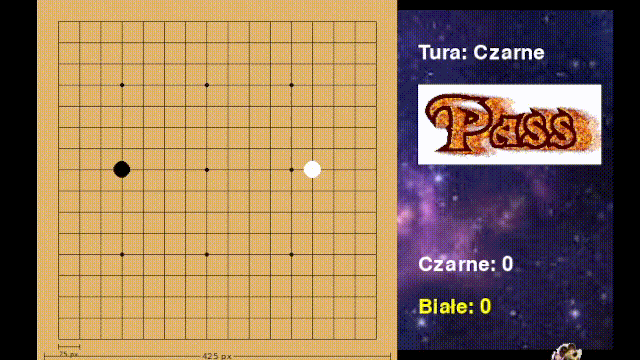

<div align="center" id="top"> 
  

  &#xa0;

  <!-- <a href="https://go.netlify.app">Demo</a> -->
</div>

<h1 align="center">Go</h1>

<p align="center">
  

  

  

  <!--  -->

  <!--  -->

  <!--  -->

  <!--  -->
</p>

<!-- Status -->

<!-- <h4 align="center"> 
	🚧  Go 🚀 Under construction...  🚧
</h4> 

<hr> -->

<p align="center">
  <a href="#dart-about">About</a> &#xa0; | &#xa0; 
  <a href="#sparkles-features">Features</a> &#xa0; | &#xa0;
  <a href="#rocket-technologies">Technologies</a> &#xa0; | &#xa0;
  <a href="#white_check_mark-instalacja">Instalacja</a>
</p>

<br>

## :dart: About

Gra go to jest fajna gra. Projekt zrobiony na lekcje informatyki. Używa pygame community edition do wyświetlania gry graficznie.

## :sparkles: Features

:heavy_check_mark: Pięknie graficznie wyświetla stan gry\
:heavy_check_mark: Na bieżąco liczy punkty\
:heavy_check_mark: Masha mode

## :rocket: Technologies

To zostało użyte do stworzenia tego projektu:

- [Python](https://www.python.org/)
- [Pygame CE](https://pypi.org/project/pygame-ce/)
- [GIF pygame](https://pypi.org/project/gif-pygame/)

## :white_check_mark: Instalacja

Pobierz gotowy plik z zakładki [releases](https://github.com/PeopleCreateBestCode/Go/releases) lub skorzystaj z poradnika poniżej:
\
Przed rozpoczęciem musisz mieć [Git](https://git-scm.com) i [Python](https://www.python.org/) zainsalowane na komputerze. (i opcjonalnie moduł [Nuitka](https://nuitka.net/) jeśli kompilujesz)

## :checkered_flag: 7

```bash
# Poniższa komenda klonuje repozytorium
$ git clone https://github.com/PeopleCreateBestCode/go.git

# Przejdź do poprawnego folderu
$ cd Go

# stwórz środowisko wirtualne
$ python -m venv .venv

# aktywacja - wybierz opcję dla swojego systemu operacyjnego
$ ./.venv/Scripts/Activate.ps1  # Windows
$ source .venv/bin/activate  # Linux

# Zainsaluj wszystkie zależności
$ pip install -r requirements.txt

# Start
$ python main.py

### Ewentualnie możesz kompilować projekt do jednego pliku exe za pomocą modułu Nuitka

# zainstaluj najnowszą wersję modułu
$ pip install --upgrade nuitka

# kompiluj
$ python -m nuitka --mode=onefile --windows-console-mode=disable --include-data-dir=assets=assets --output-filename=Go.exe main.py

```


Made with :heart: by <a href="https://github.com/PeopleCreateBestCode" target="_blank">PeopleCreateBestCode organization</a>

&#xa0;

<a href="#top">Back to top</a>
